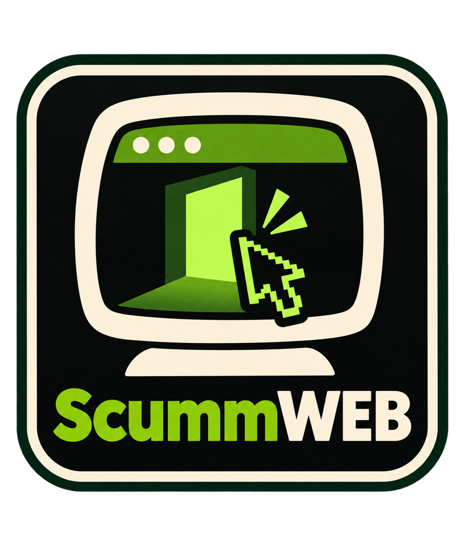

<p align="center">
  
  <br />
  <!-- repo-tagline:start -->
  <strong>🕹️ Play classic adventures in your browser 🖱️</strong>
  <!-- repo-tagline:end -->
</p>

<p align="center">
  <a href="https://github.com/tsilva/scummweb/actions/workflows/ci.yml?query=branch%3Amain"></a>
  <a href="https://github.com/tsilva/scummweb/actions/workflows/production-delivery.yml?query=branch%3Amain"></a>
  <a href="scummvm-shell/source-info.json"></a>
  <a href=".github/workflows/ci.yml"></a>
  <a href="LICENSE"></a>
</p>

ScummWEB lets you play classic point-and-click adventures in your browser,
powered by [ScummVM](https://www.scummvm.org/). Choose freeware and demos from
the public library, or import compatible games from your own collection.
Game pages bring together artwork, original gameplay screenshots, descriptions,
and launch options.

ScummWEB is an independent frontend, not affiliated with, endorsed by, or
sponsored by the ScummVM project.

## Play online

[Browse the library](https://scummweb.tsilva.eu), or start with
[Beneath a Steel Sky](https://scummweb.tsilva.eu/beneath-a-steel-sky/play), a
freeware cyberpunk adventure. The game downloads and unpacks in your browser;
when the opening scene appears, you’re ready to play. If sound or an intro is
paused, select **Start audio** inside the game.

Select a game card and **Play** to launch another adventure. Supported games
offer **Continue** when saved progress exists; other games load saves through
their in-game menu. Phones and tablets have touch controls.

Progress stays in your browser, with no automatic cloud sync. Before clearing
site data or moving devices, export a backup through **Settings → Saved games**.
See [save backups and transfers](docs/maintaining-scummweb.md#backing-up-and-transferring-saved-progress).

## Add your games

Select **Add a game** in the library to choose ZIPs. On desktop, you can also
drop them onto the homepage or a game’s page. Put one game in each ZIP, with
its data files at the root or in one enclosing folder. Local game files stay
on your device.

Only ZIP imports are supported, up to 4 GiB including unpacked contents.
For large games, use a ZIP with compression disabled. You must supply your
own files for games marked **Game not included**; recognition and artwork do
not mean the game is bundled or verified compatible.

See [playing and importing games](docs/maintaining-scummweb.md#playing-and-importing-games)
for controls, editions, file-access help, and direct ZIP links. Check the
[compatibility results](https://scummweb.tsilva.eu/compatibility) for tested
editions and known limitations; startup checks do not establish full-game compatibility.

## Run locally

Use Node.js 22 (the CI-tested version) and pnpm 10.27.0.

```bash
git clone https://github.com/tsilva/scummweb.git
cd scummweb
pnpm install --frozen-lockfile
pnpm run dev:app --port auto
```

Open the URL printed by the server, select **Beneath a Steel Sky**, then **Play**.
This setup needs no Infisical login; game downloads and artwork use their
configured public hosts.

## Further reading

- [Development, ScummVM rebuilds, and analytics](docs/maintaining-scummweb.md)
- [Artwork sources, generated artwork, and publishing](docs/maintaining-scummweb.md#artwork-storage-and-publishing)
- [Production delivery and game publishing](docs/production-delivery.md)

## License

- Original ScummWEB code is available under the [Zero-Clause BSD license](LICENSE).
- The bundled ScummVM engine and patches to ScummVM are covered by the
  [ScummVM GPL license](scummvm-shell/doc/COPYING). Bundled third-party
  components carry their own notices in the [ScummVM documentation](scummvm-shell/doc/).
- Each game and its associated artwork have their own terms. See the
  game-specific notices in the [ScummWEB catalog](https://scummweb.tsilva.eu#library).
