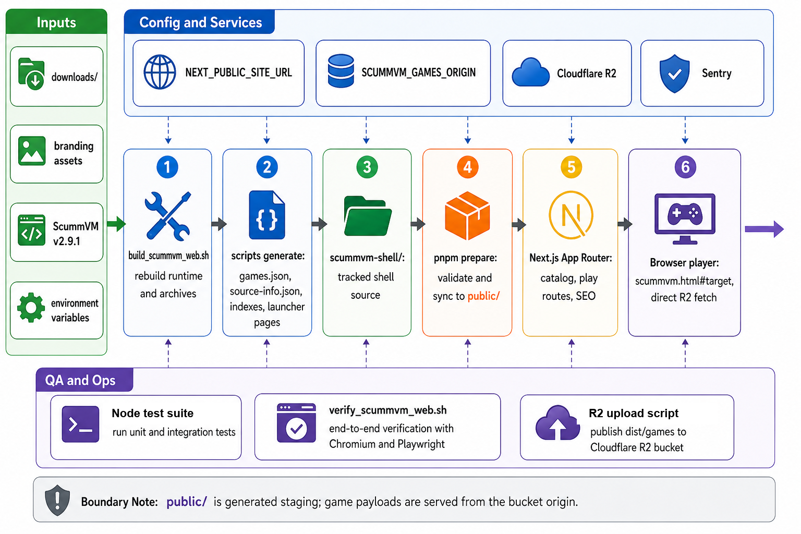

<p align="center">
  
  <br />
  <!-- repo-tagline:start -->
  <strong>🕹️ Classic point-and-click adventures, playable instantly in your browser 🕹️</strong>
  <!-- repo-tagline:end -->
</p>

[Live Demo](https://scummweb.tsilva.eu)

ScummWEB is a Next.js launcher for a curated ScummVM WebAssembly game collection. It builds static catalog pages, game detail pages, metadata routes, and a browser player that embeds the managed ScummVM shell.

The app keeps the deployable shell in this repo, while large game payloads are uploaded separately and fetched directly from a bucket origin in production. Agent interaction and gameplay experiments belong to [AgentSCUMM](https://github.com/tsilva/agentscumm); ScummWEB supplies the browser game runtime.

## Install

```bash
git clone https://github.com/tsilva/scummweb.git
cd scummweb
pnpm install
pnpm run dev --port auto
```

Open the URL printed by the server.

On the homepage, use **Play a local ZIP** to drop or choose an archive containing
one ScummVM game. The dedicated player page unpacks it and launches the first
game it detects. Put the complete game data at the root of the ZIP or inside a
single enclosing folder.
Archives can be up to 128 MiB compressed and 256 MiB unpacked. The game files
stay in browser memory until you leave the player page. Choose the ZIP again
after reloading the page.

Open **Settings** using the gear icon in the top-right bar to connect a public
HTTPS R2 or S3 bucket. Upload one game per ZIP at the bucket root using the
exact names in the filename glossary. Allow cross-origin `HEAD` and `GET` requests
from your ScummWEB site. Connect only game files you’re authorized to download
and play. If you host the files, you also need permission to make them publicly
available. Select **Check bucket**, then **Use this bucket** to save
the URL and matches in this browser. The Library restores bucket cards from those
saved matches when you return. Recheck the bucket after adding or removing ZIPs.

Click a matched Library card to open its details, then select **Play** to open
its dedicated player page. The browser downloads the ZIP directly from the saved
bucket and applies the same size limits as local ZIPs. If the player frame stays
blank on startup, the page retries it once using the downloaded files. Connecting
the official ScummWEB bucket shows the games in its existing index and keeps the standard
Library cards and player. **The Secret of Monkey Island (Demo)** is already in
the Library. Open its card and select **Play** to start the English DOS EGA demo.

## Commands

```bash
pnpm run dev             # validate/sync scummvm-shell/ into public/ and start Next.js
pnpm run build           # prepare managed shell assets and build production output
pnpm run start           # prepare managed shell assets and start the production server
pnpm run lint            # check JavaScript and JSX syntax with Next.js SWC
pnpm run test            # run the Node test suite
pnpm run verify          # build, serve, and boot detected targets through Chromium
pnpm run build:scummvm   # rebuild the ScummVM WebAssembly shell and game metadata
pnpm run publish:games   # upload dist/games payloads to Cloudflare R2
pnpm run record:preview  # stream distinct preview frames as a local MPEG-TS feed
pnpm run sentry:issues   # list recent Sentry issues from local env credentials
```

## Notes

- Local builds skip Sentry source-map uploads. Hosted Vercel builds handle uploads.
- Use `pnpm`; `package.json` rejects other package managers during install.
- `scummvm-shell/` is the tracked source of truth for managed ScummVM shell assets.
- `public/` is generated staging. Do not hand-edit staged shell files when the source lives in `scummvm-shell/`.
- Game hero banners live in `scummvm-shell/launcher/`. The catalog banners use ImageGen-restored promotional art; the gameplay screenshot galleries keep their original captures.
- The Monkey Island demo cover and banner are cropped and resized from [a scan of Steve Purcell's original DOS box art on LaunchBox Games Database](https://gamesdb.launchbox-app.com/games/images/139-the-secret-of-monkey-island). Its screenshot gallery uses [unaltered DOS EGA demo captures from DOS Games Archive](https://www.dosgamesarchive.com/download/the-secret-of-monkey-island).
- To include Monkey Island in a catalog rebuild, place the [English DOS EGA demo ZIP](https://downloads.scummvm.org/frs/demos/scumm/monkey1-dos-ega-demo-en.zip) in `downloads/` as `monkey1-dos-ega-demo-en.zip`.
- The playable baseline is Beneath a Steel Sky from `downloads/bass-cd-1.2.zip`, launched through `/scummvm.html#sky`.
- For games that support loading a save at launch, **Continue** opens the most recent save in this browser. **Start from beginning** opens a fresh session. Nippon Safes and Broken Sword 2.5 load saves from their in-game menus.
- Production game payloads are served from `SCUMMVM_GAMES_ORIGIN`; localhost can use `/games-proxy/*` for verification.
- `pnpm run verify` runs `scripts/verify_scummvm_web.sh` and needs a local Chrome or Chromium install.
- ScummWEB bundles ScummVM **2026.4.0**. See [Rebuilding and upgrading ScummVM](#rebuilding-and-upgrading-scummvm) for the source pin, patch series, and build steps.
- For an engine or shell rebuild using the existing catalog, run `SCUMMVM_REUSE_CATALOG=1 pnpm run build:scummvm`. This preserves the tracked game list and skips preparing game payloads and detecting the catalog.
- Catalog games and local ZIPs share the ScummVM WebAssembly runtime. The runtime uses the catalog target or detects the game from the local files, then loads the matching engine from `data/plugins/`. The homepage loads the ZIP decoder when you choose a file.
- The build includes detection for the bundled engines. Engine plugins are staged alongside the runtime with the managed shell assets. Keep them together when rebuilding or deploying so the runtime and its plugins come from the same build.
- `pnpm run publish:games` loads only `AWS_ACCESS_KEY_ID` and `AWS_SECRET_ACCESS_KEY` from the pinned ScummWeb Infisical Development vault using the existing human CLI login. It replaces inherited AWS credentials, blocks dotenv fallback, and pins the `scummvm-games` bucket and account endpoint. No credential export or `.env` edit is needed. Build the game payloads first, or set `SCUMMVM_GAMES_UPLOAD_DIR` to their directory.
- Publishing accepts `--game <target-or-folder>`, `--force`, and `--prune`. `--force` overwrites files; scoped uploads also refresh ancestor manifests. `--prune` deletes remote files absent locally and spans the whole bucket without `--game`. Use these flags deliberately. Website builds/deployments and existing public game delivery do not need this publishing credential.
- Sentry is optional. Runtime capture uses `NEXT_PUBLIC_SENTRY_DSN`, `SENTRY_DSN`, `NEXT_PUBLIC_SENTRY_ENABLED`, and the Sentry project settings in `next.config.js`.
- `NEXT_PUBLIC_SITE_URL` controls public metadata, sitemap, robots, and Open Graph URLs.
- The homepage hero rotates through the installed games. The ring around the pause control shows how long until the next game. Pausing freezes the countdown. Use the chevrons to choose a game. The Play button launches the game shown in the hero.
- The library’s poster cards link to each game’s detail page. Browser-Playable Classics cards open quick-play dialogs. The sitemap lists the homepage and game detail pages. The player routes and standalone emulator send noindex directives.

## Rebuilding and upgrading ScummVM

`pnpm run build:scummvm` checks out the pinned release into
`vendor/scummvm-<tag>/`, applies the ScummWEB patches, builds WebAssembly and
its engine plugins, and syncs the deployable bundle from `dist/` into
`scummvm-shell/`. The build checks that it produced a plugin for every enabled
engine before syncing the bundle.

1. Update the release tag, its upstream commit, and the matching Emscripten
   SDK in [`scripts/scummvm-version.sh`](scripts/scummvm-version.sh).
2. Run `pnpm run build:scummvm --prepare-source`. It verifies the checkout
   against the pin and applies [`patches/scummvm/`](patches/scummvm/) in filename
   order. If a patch fails, port its change against the new upstream source
   and refresh the diff with `git diff HEAD -- <path>` from the vendor checkout.
   A fully patched checkout can be reused. Keep personal edits outside it.
3. Maintain the browser UI and filesystem in [`web-shell/`](web-shell/).
   The build stages those templates with the asset version and game bucket
   origin. They own BrowserFS save compatibility, the remote filesystem,
   and the app's boot and input integration. The native filesystem patch
   lets ScummVM see those mounts through its POSIX backend. The shell also
   adapts BrowserFS operations and error codes to Emscripten 4.
4. Run `SCUMMVM_REUSE_CATALOG=1 pnpm run build:scummvm` to rebuild with the
   existing catalog. If the SDK changes the generated SDL audio glue, port
   [`scripts/patch_scummvm_audio.py`](scripts/patch_scummvm_audio.py) and rebuild.
   The audio patch must succeed before the tracked bundle is replaced.
5. Run `pnpm test` and launch a catalog game and a local ZIP in Brave.
   Check the first frame, audio, save and resume, and that the selected
   engine is the only engine plugin downloaded.

The shell uses a recursive HTTP index for each mounted filesystem. The build
generates that index for the runtime data and for any locally extracted games.
Existing published game indexes use the same format.

## Game launch analytics

On `scummweb.tsilva.eu`, GA4 tracks the following events for catalog games,
at most once per play page visit for each event.

| Event | When it fires |
| --- | --- |
| `game_launch_attempt` | The play page starts preparing the game, including looking for a browser save when Continue was requested. |
| `game_launch` | ScummVM confirms the first rendered game frame. `load_time_ms` measures time since the attempt began. |
| `game_launch_failed` | The player observes a startup error or ScummVM reports a first-frame timeout before success. `failure_reason` is `startup_error` or `first_frame_timeout`. |
| `game_play_milestone` | The ready player accumulates five minutes in the visible tab with the game controls available. `play_time_seconds` is `300`. |

The events share `game_slug`, `entry_point` (`hero`, `library`, `game_detail`, or
`direct`), and `launch_mode` (`fresh` or requested `continue`). Intro skips stay
within the same visit. The play timer pauses while the game reloads or the tab
is hidden. A visit can report a failure and later recover. Leaving before
the player reports an outcome appears as a drop-off in the funnel.
Local ZIP and external bucket launches are outside this catalog funnel.

The player fetches the catalog and engine data indexes in parallel while
WebAssembly initializes. ZIP launches fetch only the engine data index.
To diagnose a launch locally, inspect the iframe's User Timing marks in the
browser's Performance panel. `scummweb:wasm-ready` marks the start of filesystem
setup, `scummweb:index:games` and `scummweb:index:data` mark completion of each
index fetch, and `scummweb:filesystems-ready` marks when ScummVM can start.
`scummweb:first-game-frame` marks the first detected rendered frame for catalog
launches. These marks use the iframe's navigation as their time origin.

In GA4 Explorations, build a closed funnel from `game_launch_attempt` to
`game_launch` to `game_play_milestone` to compare users at each step. For
counts by play page visit, report **Event count** by event name. Use
**Page path** to focus on a game and **Session source / medium** to break down
acquisition. Analyze `game_launch_failed` separately. To report on the custom fields, register
`game_slug`, `entry_point`, `launch_mode`, and `failure_reason` as event-scoped
custom dimensions and `load_time_ms` as a custom metric.

## Architecture



## License

No repository-level license file is currently included.

`pnpm sentry:issues -- --help` uses the managed development token. Private tokens in local Sentry env files are ignored.

Production delivery runs on pushes to `main` and supports manual secret rotations. See [production delivery](docs/production-delivery.md) for destinations, access boundaries and failure behavior.

Production secrets are delivered through the pinned shared GitHub Actions workflow. The standalone signed Infisical relay triggers synchronization and deployment; see [production delivery](docs/production-delivery.md) for scope and recovery.

Production delivery keeps Vercel secret isolation enabled and distinguishes public configuration from private credentials; see [production delivery](docs/production-delivery.md).
